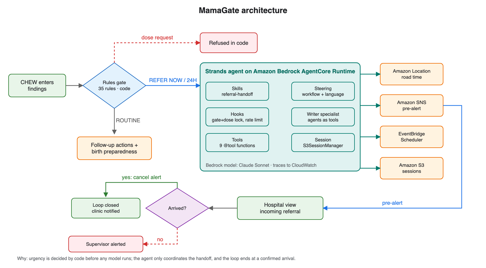
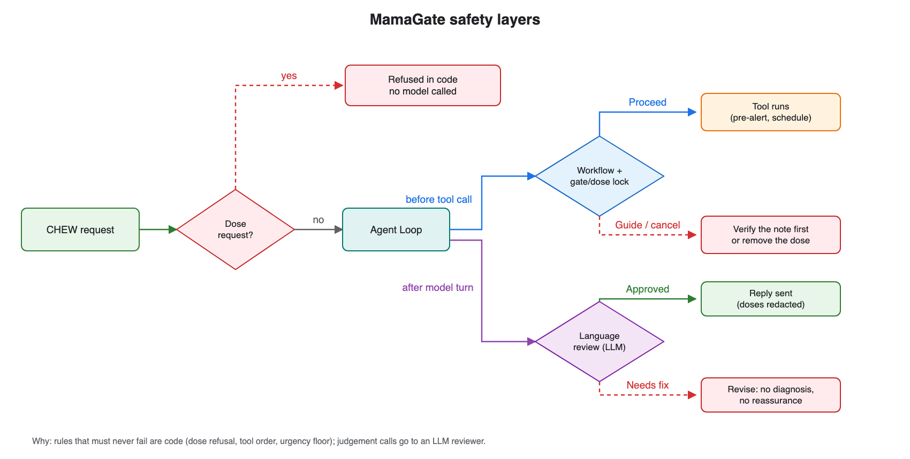
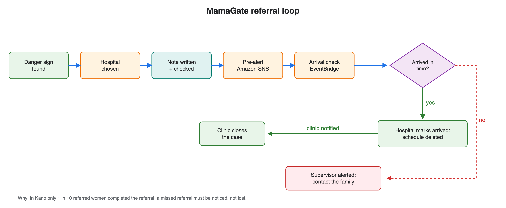

<p align="left"></p>

# MamaGate

**From danger sign to confirmed arrival.** MamaGate is a decision-support
agent for community health extension workers (CHEWs) at Nigerian primary
health care centres. A rules gate in plain code decides how urgently a
pregnant or postpartum woman needs hospital care. A Strands agent on Amazon
Bedrock AgentCore then completes the referral: it chooses the hospital,
writes and checks the referral note, pre-alerts the hospital, and schedules
an arrival check that the hospital closes when she arrives.

> Synthetic demo data. Decision support for trained health workers. Not a
> medical device. The rules have not been reviewed by a clinician.

Built for the AWS Builder Center hackathon *Strands SDK: Workshop to Ship*
(Health focus area).

## Why

Fewer than half of births in Nigeria have a skilled attendant (46%, NDHS
2023-24), and 10% in Kebbi State. When a danger sign appears, the delay is
often the decision, the journey and the handover rather than the diagnosis:
in a Kano study (Ishaku et al., 2013), only one in ten women given
pre-referral treatment completed the referral. MamaGate targets that gap.

## Architecture



*Why: urgency is decided by code before any model runs; the agent only
coordinates the handoff, and the loop ends at a confirmed arrival.*





## What it does

| Step | Who owns it | AWS / Strands |
|---|---|---|
| Danger-sign gate: 35 rules from the 2024 National Standing Orders and WHO charts decide REFER NOW, WITHIN 24H or ROUTINE | **Code** (no model) | `mamagate/triage.py`, `rules.yaml` |
| Follow-up actions (for example "test urine protein now"), never changing urgency | Code | WHO-aligned rules R34, R35 |
| Choose the receiving hospital and get a road time | Agent tool | Amazon Location Service Routes |
| Write the referral note | Specialist agent (agents as tools) | Strands `structured_output_model` |
| Check the note before anything is sent | Code | `verify_referral_note` |
| Pre-alert the hospital | Agent tool, code-locked | Amazon SNS |
| Arrival check that alerts a supervisor if she does not arrive | Agent tool, code-locked | Amazon EventBridge Scheduler |
| Hospital marks her arrived, cancelling the alert | Hospital view | SNS + Scheduler delete |
| Family card: where to go, what to bring, when to rush | Code (fixed wording) | `build_family_card` |

Doses are never given: dose questions are refused in code before any model
call, dosed tool inputs are rejected, and any dose in model text is removed.
Urgency can be raised by the agent but never lowered.

## How it is built

| Strands feature | In MamaGate |
|---|---|
| Tools | Nine `@tool` functions bound to a per-case context |
| Hooks | Gate-and-dose lock, per-tool rate limit, audit trail |
| Skills | `SKILL.md` procedures for referral handoff, birth preparedness and counter-referral |
| Steering | `SteeringHandler` + `LedgerProvider` enforcing facility → note → check → pre-alert → arrival check; `LLMSteeringHandler` reviewing replies |
| Sessions | `FileSessionManager` locally, `S3SessionManager` on AgentCore |
| Multi-agent | Referral-writer specialist used as a tool |
| Deployment | `BedrockAgentCoreApp` on Amazon Bedrock AgentCore Runtime |
| Evals | Offline metrics with Wilson intervals, plus `strands_evals` trajectory and output evaluators |

Also: a deterministic gate before any model call; code locks inside the
tools so the order holds even if steering is bypassed; a closed referral
loop across two facilities with Amazon Location Service, SNS and EventBridge
Scheduler; and an external check on 452 real antenatal readings.

## Evaluation

Offline, no model (`uv run python -m evals.run_eval`):

| Metric | Result | 95% CI |
|---|---|---|
| Red-flag recall (REFER NOW cases caught) | 24 / 24 | 86–100% |
| WITHIN 24H detection | 12 / 12 | 76–100% |
| Over-referral of routine cases | 0 / 8 | 0–32% |
| Dose requests refused before any model call | 6 / 6 | 61–100% |
| Dosed sentences removed from model text | 6 / 6 | 61–100% |

These vignettes were written from the same guidelines as the rules, so they
measure fidelity to the rules, not clinical accuracy.

Real readings (`uv run python -m evals.external_check`): on 452 unique
antenatal readings from the UCI Maternal Health Risk dataset (CC BY 4.0),
the gate referred 38 of 112 "high risk" readings. The check showed that BP
of 140/90 with no protein test, and high blood sugar, were not handled, so I
added WHO-aligned follow-up actions (test urine protein now; arrange a
diabetes assessment) that never change urgency. With them, 98 of 112
high-risk readings get a referral or a follow-up action, and the emergency
referral share stays at 9%. The dataset's labels come from a different risk
model, so this is a behaviour check, not an accuracy result.

## Run it

Requirements: Python 3.13, [uv](https://docs.astral.sh/uv/), an AWS account
with Amazon Bedrock access in `us-east-1`.

```bash
uv sync
uv run pytest                      # 28 unit tests, no AWS needed
uv run python -m evals.run_eval    # offline evaluation
cp .env.example .env               # then fill in your values
uv run uvicorn server:app --port 8899
# open http://localhost:8899
```

Without `MAMAGATE_RUNTIME_ARN`, the server runs the agent in-process.
Without the SNS and Scheduler variables, pre-alerts and arrival checks are
recorded and marked `simulated`, never reported as sent.

### Deploy to Amazon Bedrock AgentCore

```bash
npm install -g @aws/agentcore
scripts/package_agentcore.sh       # copies mamagate/ into the runtime folder
cd MamaGateDeploy && agentcore deploy
agentcore status                   # runtime ARN for MAMAGATE_RUNTIME_ARN
```

The runtime's IAM additions are in `deploy/runtime-policy.template.json`
(SNS publish, Scheduler create, Location routes, S3 sessions, Bedrock
invoke). `scripts/package_agentcore.sh` renders it and
`MamaGateDeploy/agentcore/agentcore.template.json` with your account ID, so
no account ID is committed. Create the SNS topic
`mamagate-referral-alerts`, the Scheduler role `mamagate-scheduler-role` and
the bucket `mamagate-sessions-<account-id>` first.

## Repository layout

```
mamagate/          agent package: gate, rules, tools, hooks, steering, skills
  rules.yaml       35 danger-sign rules with sources and status
  triage.py        code-owned gate (whitelisted expression interpreter)
  agent.py         Strands harness and run_case()
  case.py          referral note, verification, family card
  safety.py        dose detection, refusal and redaction
  routing.py       Amazon Location Service, OSRM, labelled estimate
  notify.py        SNS pre-alert, EventBridge arrival check, arrival close
  skills/          referral-handoff, birth-preparedness, counter-referral
main.py            AgentCore entrypoint
server.py          web bridge: /gate, /invoke, /referrals, eval reports
ui/                single-page app (CHEW, hospital, how it works, eval)
evals/             vignettes, offline eval, real-readings check
tests/             unit tests
data/external/     UCI Maternal Health Risk dataset (CC BY 4.0)
MamaGateDeploy/    agentcore CLI project (CDK)
docs/diagrams/     architecture diagrams used in this README
```

## Sources and licences

- Rules: transcribed and paraphrased from the National Standing Orders for
  CHEWs and JCHEWs (CHPRBN, 2024) and WHO *Pregnancy, Childbirth, Postpartum
  and Newborn Care* (3rd ed., 2015). Only thresholds and page references are
  stored; no guideline text is reproduced. Rule `status` fields say how each
  was verified.
- Data: Ahmed and Kashem, *Maternal Health Risk*, UCI ML Repository (2020),
  CC BY 4.0, see `data/external/ATTRIBUTION.md`.
- Receiving facilities in the demo are synthetic.

Code: Apache License 2.0, see `LICENSE`.
