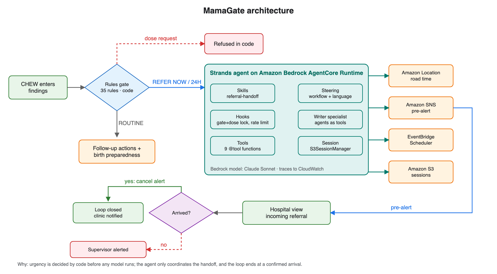
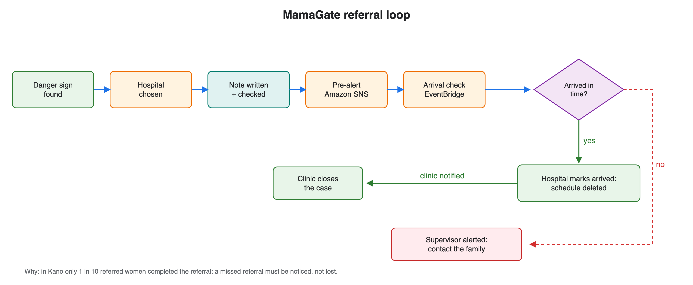
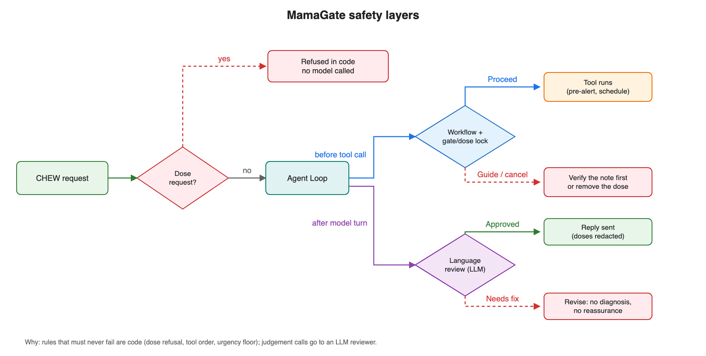

# MamaGate: A Maternal Referral Agent for Nigeria's Frontline Health Workers

*A rules gate and referral relay for community health workers in Nigerian
primary health care. Health focus area.*

**Code:** [github.com/ogasege/mamagate](https://github.com/ogasege/mamagate)

> Synthetic demo data. Decision support for trained health workers. Not a
> medical device. The rules have not been reviewed by a clinician.

[](https://youtu.be/mhFnBA8rcGI)

## The problem

Nigeria has about **7.5 million births a year**, and about **75,000 women
die** from pregnancy and childbirth every year, roughly 29% of all maternal
deaths worldwide ([WHO, Trends in maternal mortality 2000–2023](https://www.who.int/publications/i/item/9789240108462)).
Fewer than half of births have a skilled attendant: **46% nationally**, which
leaves about **4 million births a year** without one. In Kebbi State, the
lowest of any state, the figure is just **10%**, against 87% in Lagos. The
need is greatest in the rural North ([Nigeria Demographic and Health Survey 2023-24](https://dhsprogram.com/publications/publication-SR294-Summary-Reports-Key-Findings.cfm)).
In many rural primary health care centres the person in front of a pregnant
woman is a community health extension worker (CHEW), often alone and with no
doctor on site.

When a danger sign appears, three delays decide what happens next: deciding
to seek care, reaching care, and receiving care. Nigeria's evidence points
at the handover. In a Population Council study at Kano primary health care
centres ([Ishaku et al., *Health*, 2013](https://doi.org/10.4236/health.2013.59199); fieldwork 2010-11), only one in ten
women given pre-referral treatment for severe pre-eclampsia went on to
complete the referral, against 44% of controls. Treatment felt like care,
and the journey to hospital did not happen.

MamaGate is built for that moment. It is used by the CHEW, and it exists for
the woman.

## What MamaGate does

1. **The CHEW enters what she measured.** Blood pressure, pulse, temperature,
   bleeding, symptoms. Anything not measured is left empty, and empty is
   never treated as normal.
2. **A rules gate decides urgency, in code, before any AI runs.** Thirty-five
   danger-sign rules transcribed from Nigeria's 2024 [National Standing Orders
   for CHEWs](https://chprbn.gov.ng/standingorders/) and WHO's [*Pregnancy, Childbirth, Postpartum and Newborn
   Care*](https://iris.who.int/handle/10665/249580) charts return REFER NOW, WITHIN 24H or ROUTINE in about a millisecond,
   with the source page for every rule that fired.
3. **A Strands agent on Amazon Bedrock AgentCore completes the referral.**
   It chooses the receiving hospital with a real road time from Amazon
   Location Service, writes a structured referral note, has code check the
   note, pre-alerts the hospital through Amazon SNS, and schedules an arrival
   check with Amazon EventBridge Scheduler.
4. **The family gets a plain-language card:** where to go, how long it
   takes, what to bring (money, a companion, a blood donor), and which signs
   mean go at once, in English, Pidgin, Hausa, Yoruba and Igbo. Fixed
   wording, no diagnosis, no doses; translations are drafts awaiting native
   clinical review.
5. **The hospital closes the loop.** The receiving ward sees the referral
   before she arrives. One tap marks her arrived, which deletes the pending
   supervisor alert and tells the clinic. If she never arrives, the
   supervisor is alerted, so a missed referral is noticed instead of lost.

Who is it for? Not a patient self-triage app, on purpose: the gate needs
measurements a woman cannot take at home, a missed alarm at home is exactly
the delay that kills, and only [30% of Nigerian women own a smartphone](https://dhsprogram.com/publications/publication-SR294-Summary-Reports-Key-Findings.cfm).
Patient chatbots already exist; the referral handover between two
facilities is the gap.

## Architecture



**Why it is shaped this way:** urgency is decided by code before any model
runs, because it must be deterministic, testable and auditable. The agent
only coordinates the handoff, and the flow ends at a confirmed arrival,
because arrival is the outcome that matters.



**Why a loop:** in Kano only one in ten referred women completed the
referral. A referral that never arrives has to be noticed, so an
EventBridge schedule alerts a supervisor unless the hospital marks her
arrived.



**Why two kinds of guard:** rules that must never fail (dose refusal, tool
order, the urgency floor) are code; judgement calls (tone, diagnosis
wording) go to an LLM reviewer.

## Technical execution with the Strands Agents SDK

- **Tools.** Nine `@tool` functions bound to a per-case context: triage
  result, facility search, facility selection, note drafting, note
  verification, pre-alert, arrival check, urgency raise, arrival record.
- **Hooks.** A `BeforeToolCallEvent` lock refuses any tool without a gate
  result and rejects dosed tool inputs; a per-tool rate limit stops runaway
  loops; an `AfterToolCallEvent` audit hook records every step for the trace
  view.
- **Skills.** The referral, birth-preparedness and counter-referral
  procedures are `SKILL.md` files loaded on demand with `AgentSkills`.
- **Steering.** A `SteeringHandler` with `LedgerProvider` enforces the order
  facility → note → verify → pre-alert → arrival check; an
  `LLMSteeringHandler` reviews replies for doses, reassurance and diagnosis
  wording.
- **Multi-agent.** A referral-writer specialist is called as a tool and
  returns typed fields through `structured_output_model`.
- **Sessions.** `FileSessionManager` locally, `S3SessionManager` on
  AgentCore.
- **Deployment.** `BedrockAgentCoreApp` entrypoint, deployed to Amazon Bedrock
  AgentCore Runtime with the `agentcore` CLI, traced in CloudWatch.
- **Evaluation.** `strands_evals` trajectory and output evaluators, plus an
  offline harness with Wilson confidence intervals.

## What makes it different

- **Code decides what must never be wrong.** Urgency comes from a
  whitelisted expression interpreter over a YAML rules file, not from a
  model. The agent can raise urgency but never lower it.
- **Locks inside the tools, not only around them.** During testing, a note
  failed verification four times and the pre-alert still went out, because a
  steering decision did not fire for that tool. I moved the rule into the
  tool itself: `send_pre_alert` now refuses to run unless the note passed
  verification, whatever the prompt or the steering does.
- **A closed referral loop across two facilities.** Amazon Location Service
  for road time, Amazon SNS for the pre-alert, Amazon EventBridge Scheduler
  for an arrival check that the hospital cancels when she arrives. Most
  agents end at an answer; this one ends at a confirmed arrival.
- **Honest outputs.** Anything not really sent is labelled `simulated`;
  routing says which provider produced the time; an unknown hospital
  capability is shown as unknown.

## Social impact and how it would be measured

The outcome that matters is **referral completion**: the share of women
referred who arrive at the receiving facility, confirmed by counter-referral.
The Kano baseline is 10% after pre-referral treatment and 44% without. A
pilot would measure completion and time from danger sign to arrival, with
the supervisor alerts as the safety net.

What I can measure tonight, offline:

| Metric | Result | 95% CI |
|---|---|---|
| REFER NOW cases caught by the gate | 24 / 24 | 86–100% |
| WITHIN 24H cases caught | 12 / 12 | 76–100% |
| Routine cases wrongly escalated | 0 / 8 | 0–32% |
| Dose requests refused before any model call | 6 / 6 | 61–100% |
| Dosed model sentences removed | 6 / 6 | 61–100% |

These cases were written from the same guidelines as the rules, so they
measure fidelity to the rules, not clinical accuracy.

## What I learned

1. **Real data found a gap that synthetic cases did not.** I ran the gate
   over 452 unique antenatal readings from the [UCI Maternal Health Risk
   dataset](https://archive.ics.uci.edu/dataset/863/maternal+health+risk). It referred only 38 of 112 "high risk" readings. Most of the rest
   had BP of 140/90 or more with no protein test recorded, or high blood
   sugar. My first fix made both a 24-hour referral; that was stricter than
   WHO and nearly doubled low-risk flags. Following the [WHO antenatal care
   decision logic](https://www.who.int/publications/i/item/9789240020306) instead, they became follow-up actions (test urine protein
   now; arrange a diabetes assessment) that never change urgency. Now 98 of
   112 get a referral or an action, and emergency referrals stay at 9%.
2. **A measured volume is not a dose.** My first note checker rejected
   "400 ml of blood loss" as a dose and blocked every haemorrhage referral.
   Dose detection now needs a quantity in the same sentence as a drug name
   or an administration word.
3. **An LLM reviewer on every tool call is expensive.** Steering every tool
   call with a second model call made one consultation take twelve minutes
   on AgentCore. Reviewing only replies, and governing tools in code,
   brought it to about thirty to sixty seconds.
4. **Fidelity is not validity.** Without a clinician, my evaluation measures
   whether the code matches the guidelines I transcribed, not whether the
   guidelines were applied well. A clinical review of `rules.yaml` is the
   first step before any pilot.

## Limits

The rules are not clinically reviewed; the receiving hospitals are
synthetic; no health worker or patient has used MamaGate; clinical output is
English, and the family-card translations are drafts awaiting native clinical
review; and its effect on referral completion is unknown until a pilot
measures it.

## Try it

```bash
git clone https://github.com/ogasege/mamagate && cd mamagate
uv sync && uv run pytest && uv run python -m evals.run_eval
uv run uvicorn server:app --port 8899   # then open http://localhost:8899
```

Built with the Strands Agents SDK, Amazon Bedrock AgentCore, Amazon Bedrock,
Amazon Location Service, Amazon SNS, Amazon EventBridge Scheduler and Amazon
S3.

## Sources

- [Nigeria Demographic and Health Survey 2023-24, Summary Report](https://dhsprogram.com/publications/publication-SR294-Summary-Reports-Key-Findings.cfm). National Population Commission and ICF, The DHS Program.
- WHO, UNICEF, UNFPA, World Bank Group and UNDESA. [Trends in maternal mortality 2000 to 2023](https://www.who.int/publications/i/item/9789240108462), 2025.
- Ishaku S, Ahonsi B, Tukur J, Oginni A. [Attrition from care after the critical phase of severe pre-eclampsia and eclampsia](https://doi.org/10.4236/health.2013.59199). *Health* 5(9): 1461-1466, 2013.
- [National Standing Orders for CHEWs and JCHEWs, 2024 edition](https://chprbn.gov.ng/standingorders/). Community Health Practitioners Registration Board of Nigeria.
- WHO. [*Pregnancy, Childbirth, Postpartum and Newborn Care: A guide for essential practice*, 3rd edition](https://iris.who.int/handle/10665/249580), 2015.
- WHO. [*Digital adaptation kit for antenatal care*](https://www.who.int/publications/i/item/9789240020306), 2021.
- WHO. [*Diagnostic criteria and classification of hyperglycaemia first detected in pregnancy*](https://www.who.int/publications/i/item/WHO-NMH-MND-13.2), 2013.
- Ahmed M, Kashem MA. [*Maternal Health Risk*](https://archive.ics.uci.edu/dataset/863/maternal+health+risk). UCI Machine Learning Repository, 2020 (CC BY 4.0).
- [Strands Agents SDK documentation](https://strandsagents.com).
- [Amazon Bedrock AgentCore documentation](https://docs.aws.amazon.com/bedrock-agentcore/).
